 ****  **About me**

  

### 📊 My Github Stats:

  

  

## My Streak

  

## My Ranks

  

[resume]: https://drive.google.com/file/d/1ryZi4rw91dM1LL62zYgHpemjKuxkWHdx/view?usp=sharing

## ✍️ Random Dev Quote

  

# Diagram

  

# My Waka Time

  

